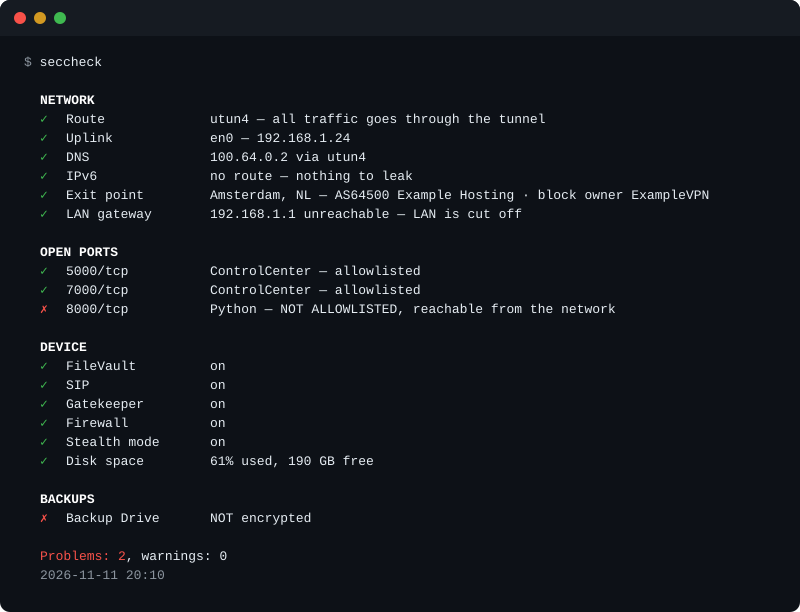

# seccheck

[](https://github.com/yaroslavtkachenko-dev/seccheck/actions/workflows/ci.yml)
[](LICENSE)

**Is your Mac actually in the state you think it is?** One command answers: is the traffic really inside the VPN, is DNS leaking, what is listening on the network, is the disk encrypted, are the backups.

One zsh file. No sudo, no dependencies, nothing to install besides the script.



[Українською](README.uk.md)

## Why

I spent an hour checking my own Mac by hand and found a forgotten `python3 -m http.server` that had been serving a folder to the local network for two weeks. Nothing had warned me. seccheck is that hour turned into one command, plus a background agent that speaks up only when something *changes*.

It is deliberately small. It is not a compliance scanner and does not replace [Lynis](https://github.com/CISOfy/lynis), which audits far more. It covers the few things that silently drift on a laptop that lives behind a VPN.

## What it checks

| Area | Check | It is a problem when |
|---|---|---|
| Network | Route | the default route does not go into the tunnel |
| | DNS | resolver #1 is not bound to the tunnel interface, so queries go to the local provider |
| | IPv6 | there is an IPv6 default route outside the tunnel |
| | Exit point | the public address does not belong to your VPN provider |
| | LAN gateway | the local gateway answers, so the local network can see you (a warning) |
| Open ports | Listeners | a process outside the allowlist listens on a non-loopback address |
| Device | FileVault, SIP, Gatekeeper, firewall | any of them is off |
| | Stealth mode | it is off (a warning) |
| | Disk space | the disk is 85% full (a warning) or 95% full |
| Backups | Time Machine | a destination is not encrypted |

An unencrypted backup undoes FileVault: whoever carries the drive away reads everything without a password.

No VPN? Set `VPN_EXPECTED=0` and the tunnel checks become informational.

## Install

```bash
git clone https://github.com/yaroslavtkachenko-dev/seccheck.git
cd seccheck
./seccheck
```

To run it from anywhere, link it into a directory on your `PATH`:

```bash
ln -s "$PWD/seccheck" /usr/local/bin/seccheck
```

Then tell it which VPN you use:

```bash
seccheck --init-config
```

This writes a commented config to `~/.config/seccheck/seccheck.conf`. Until `VPN_ORG_MATCH` is set, the exit point is shown with a warning, because there is nothing to verify it against.

Developed and tested on macOS 26 and 27 on Apple Silicon. Older versions are untested.

## Usage

```bash
seccheck              # full report
seccheck --quiet      # problems only, for background runs
seccheck --json       # for scripts
seccheck --no-net     # no outbound requests
seccheck --notify     # a macOS notification when the set of problems changes
```

Exit codes: `0` clean, `1` warnings, `2` problems.

```json
{"version":"1.0.0","ts":"2026-11-11T21:09:31Z","warnings":0,"failures":1,"rows":[
  {"status":"ok","check":"Route","value":"utun4 — all traffic goes through the tunnel"},
  {"status":"bad","check":"8000/tcp","value":"Python — NOT ALLOWLISTED, reachable from the network"}
]}
```

## Background agent

```bash
seccheck --install-agent          # every 30 minutes
seccheck --install-agent 600      # every 10 minutes
seccheck --uninstall-agent
```

This installs a LaunchAgent, `io.github.yaroslavtkachenko-dev.seccheck`, which runs `seccheck --quiet --notify`. The log is `~/Library/Logs/seccheck.log`.

**Notifications fire on a change of state, not on the state.** If a backup has been unencrypted for three weeks, you were told once. Only what was not there last time makes noise: a new listener, a vanished tunnel, FileVault switched off. When the last problem goes away, you get one "all clear".

A monitor that repeats the same thing every half hour becomes noise within two days, and the one new line gets lost with the old reminder.

## An ASN is not an owner

The first version checked the exit point by comparing the ASN name of the public address with the VPN provider's name. It then raised a false alarm for twelve days on perfectly healthy connections.

The ASN name is the network that *announces* the route. That is not necessarily who the addresses belong to. My provider's servers in one city sit in a block registered to the provider's own network company but announced by a hosting company. One IP lookup service named the hosting company; another, working from older data, named an ISP on another continent. Neither named the VPN.

So when the ASN does not match, seccheck now asks the address registry (RDAP) who the block is registered to, and only then decides. It reads only the fields that state ownership (the network name, its remarks and the names of the entities attached to it) and matches whole words, so the check fails closed.

The same incident exposed a second bug. The alarm text contained the exit address, and a problem was identified by its text, so every reconnect looked like a new problem: 45 notifications in twelve days, from a tool built on not repeating itself. A problem is now identified by a stable key that contains neither volatile values nor translated text.

## Configuration

`seccheck --init-config` writes the file with every option explained. The ones you are likely to touch:

| Option | Meaning |
|---|---|
| `VPN_EXPECTED` | `1` if a missing tunnel is a problem, `0` if you do not use a VPN |
| `VPN_ORG_MATCH` | case-insensitive regex, matched as whole words, naming who should own your exit address, e.g. `"ExampleVPN\|Example Networks"`: the brand, plus the company its address blocks are registered to |
| `ALLOWED_LISTENERS` | process names allowed to listen on the network |
| `RDAP_ENDPOINT` | the registry to ask about a block; empty disables the second look |
| `UI_LANG` | `en` or `uk`; empty follows the macOS language |

To find the right `VPN_ORG_MATCH`: connect the VPN, run `seccheck`, read the "Exit point" row, then look at `curl -s https://rdap.org/ip/<that address>`.

Paths can be overridden with `SECCHECK_CONF`, `SECCHECK_STATE`, `SECCHECK_LOG`; the language with `SECCHECK_LANG`.

## What it talks to

- `ipinfo.io`, falling back to `ifconfig.co`: one GET to learn the public address. They see your exit address and nothing else.
- `rdap.org`, which redirects to the regional registry: only when the ASN does not match, and the request contains the exit address.

`--no-net` skips all of it. There is no telemetry. Everything else is local system utilities: `route`, `scutil`, `ifconfig`, `netstat`, `lsof`, `fdesetup`, `csrutil`, `spctl`, `socketfilterfw`, `df`, `defaults`, `plutil`.

seccheck only reads. The only things it writes are its own state file, its log and, if you ask for it, the LaunchAgent.

## Notes and limits

- **The allowlist is by process name, not by port**, because `rapportd` takes a new port on every boot. This is a hygiene check: it catches what you forgot, not malware that names itself `rapportd`.
- **Listeners owned by root show up as unknown.** Their names are not visible without sudo; such rows are warnings. Run `sudo seccheck` to see them.
- **The LAN gateway row is the view of the process that runs seccheck.** macOS can deny local network access to the app you start it from; a ping then never leaves the Mac, exactly as it would under a VPN kill switch. The row says "blocked for this process" in that case and does not claim the LAN is cut off. The background agent may see the LAN differently from your terminal.
- **TCP only.** UDP listeners are not listed.
- **Time Machine only.** Other backup tools are not inspected.
- **A full tunnel on a `utun` interface is assumed.** Split tunnelling will look like a leak.

## Languages

English and Ukrainian. The output follows the macOS language unless `UI_LANG` says otherwise.

## Tests

```bash
zsh tests/run.zsh
```

The tests are offline: the exit address and the registry record come from local files, and `osascript` is replaced by a stub, so no notification is sent and nothing in your home directory is touched.

## Roadmap

A menu bar indicator. The checks are of two kinds: volatile ones (tunnel, exit point, listeners) that you want to see at a glance, and static ones (FileVault, backups) that suit a rare notification. Today both go through one channel. The plan is a thin SwiftUI `MenuBarExtra` over `seccheck --json`; the script stays the engine.

## License

[MIT](LICENSE)
