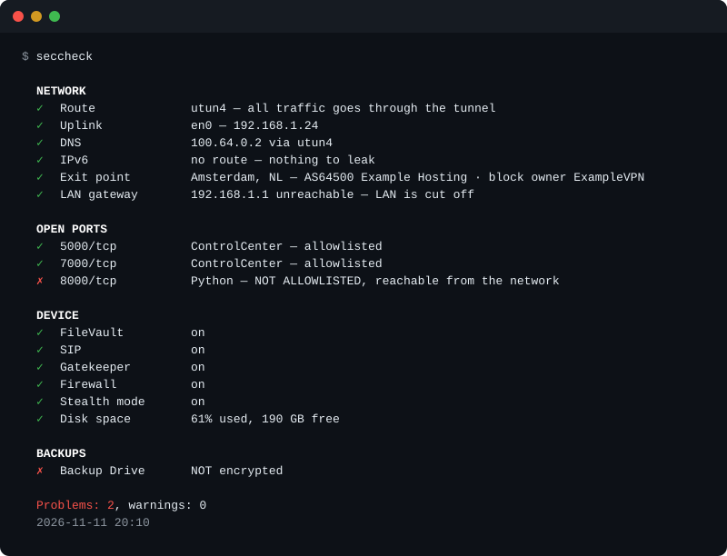

# seccheck

**Чи справді твій Mac у тому стані, в якому ти думаєш?** Одна команда відповідає: чи трафік справді в тунелі VPN, чи не тече DNS, що слухає мережу, чи зашифрований диск і чи зашифровані бекапи.

Один файл на zsh. Без sudo, без залежностей, крім самого скрипта нічого ставити не треба.



[English](README.md)

## Навіщо

Я годину перевіряв власний Mac руками і знайшов забутий `python3 -m http.server`, який два тижні роздавав теку всім у локальній мережі. Ніщо про це не попередило. seccheck — це та година, згорнута в одну команду, плюс фоновий агент, який озивається лише тоді, коли щось *змінилось*.

Він навмисно малий. Це не сканер відповідності стандартам і не заміна [Lynis](https://github.com/CISOfy/lynis), який перевіряє значно більше. Він стежить за кількома речами, які непомітно з'їжджають на ноутбуці, що живе за VPN.

## Що перевіряє

| Розділ | Перевірка | Проблема, якщо |
|---|---|---|
| Мережа | Маршрут | маршрут за замовчуванням іде не в тунель |
| | DNS | резолвер №1 не прив'язаний до інтерфейсу тунелю, і запити йдуть місцевому провайдеру |
| | IPv6 | є маршрут IPv6 за замовчуванням поза тунелем |
| | Точка виходу | зовнішня адреса не належить твоєму VPN-провайдеру |
| | Локальний шлюз | шлюз відповідає, тобто тебе видно в локальній мережі (попередження) |
| Відкриті порти | Слухачі | процес поза списком дозволених слухає не на `127.0.0.1` |
| Пристрій | FileVault, SIP, Gatekeeper, фаєрвол | щось із цього вимкнено |
| | Stealth mode | вимкнено (попередження) |
| | Місце на диску | диск зайнятий на 85% (попередження) або на 95% |
| Бекапи | Time Machine | призначення не зашифроване |

Незашифрований бекап зводить нанівець FileVault: диск виносять і читають усе без пароля.

Не користуєшся VPN? Постав `VPN_EXPECTED=0`, і перевірки тунелю стануть довідковими.

## Встановлення

```bash
git clone https://github.com/yaroslavtkachenko-dev/seccheck.git
cd seccheck
./seccheck
```

Щоб запускати звідусіль, зроби посилання в теці з `PATH`:

```bash
ln -s "$PWD/seccheck" /usr/local/bin/seccheck
```

Далі скажи йому, який у тебе VPN:

```bash
seccheck --init-config
```

Команда створює конфіг із поясненнями в `~/.config/seccheck/seccheck.conf`. Поки `VPN_ORG_MATCH` не заданий, точка виходу показується з попередженням, бо її нема з чим звірити.

Розроблено й перевірено на macOS 26 і 27 на Apple Silicon. На старіших версіях не перевірялось.

## Використання

```bash
seccheck              # повний звіт
seccheck --quiet      # тільки проблеми, для фонових запусків
seccheck --json       # для скриптів
seccheck --no-net     # без звернень у мережу
seccheck --notify     # сповіщення macOS, коли набір проблем змінився
```

Коди виходу: `0` чисто, `1` попередження, `2` проблеми.

## Фонове стеження

```bash
seccheck --install-agent          # кожні 30 хв
seccheck --install-agent 600      # кожні 10 хв
seccheck --uninstall-agent
```

Ставить LaunchAgent `io.github.yaroslavtkachenko-dev.seccheck`, який запускає `seccheck --quiet --notify`. Лог лежить у `~/Library/Logs/seccheck.log`.

**Сповіщення приходять на зміну стану, а не на стан.** Якщо бекап незашифрований третій тиждень, нагадування про це прийшло один раз. Озивається лише те, чого не було минулого разу: новий слухач на порту, зниклий тунель, вимкнений FileVault. Коли остання проблема зникає, приходить одне повідомлення «чисто».

Монітор, який щопівгодини повторює те саме, за два дні перетворюється на шум, і разом зі старим нагадуванням губиться справді нове.

## ASN — це не власник

Перша версія перевіряла точку виходу так: порівнювала назву ASN зовнішньої адреси з назвою VPN-провайдера. Після цього вона дванадцять днів давала хибну тривогу на цілком справному з'єднанні.

Назва ASN — це мережа, яка *анонсує* маршрут. Вона не обов'язково та, кому належать адреси. Сервери мого провайдера в одному з міст стоять у блоці, зареєстрованому на його власну мережеву компанію, але анонсує цей блок сторонній хостинг. Один сервіс визначення адрес називав хостинг, інший, зі старішими даними, — провайдера з іншого континенту. Жоден не назвав VPN.

Тому тепер, якщо ASN не збігся, seccheck питає реєстр адрес (RDAP), на кого зареєстрований блок, і лише тоді вирішує. Він читає тільки ті поля, що кажуть про власника (назву мережі, примітки до неї та імена пов'язаних організацій), і шукає збіг цілими словами, тож у разі сумніву перевірка не проходить.

Той самий випадок показав другу помилку. У тексті тривоги була адреса виходу, а проблема впізнавалась за текстом, тож кожне перепідключення виглядало як нова проблема: 45 сповіщень за дванадцять днів від інструмента, збудованого на тому, щоб не повторюватись. Тепер проблема впізнається за стабільним ключем, у якому немає ні мінливих значень, ні перекладеного тексту.

## Налаштування

`seccheck --init-config` створює файл, де пояснено кожен параметр. Ті, які найімовірніше доведеться міняти:

| Параметр | Значення |
|---|---|
| `VPN_EXPECTED` | `1`, якщо відсутній тунель є проблемою; `0`, якщо VPN не використовується |
| `VPN_ORG_MATCH` | регулярний вираз без урахування регістру, збіг лише цілими словами: кому має належати адреса виходу, напр. `"ExampleVPN\|Example Networks"`: бренд і компанія, на яку зареєстровані його блоки адрес |
| `ALLOWED_LISTENERS` | імена процесів, яким дозволено слухати мережу |
| `RDAP_ENDPOINT` | реєстр, у якого питати про блок адрес; порожнє значення вимикає цю перевірку |
| `UI_LANG` | `en` або `uk`; порожнє значення бере мову macOS |

Як підібрати `VPN_ORG_MATCH`: підключи VPN, запусти `seccheck`, подивись рядок «Точка виходу», потім `curl -s https://rdap.org/ip/<ця адреса>`.

Шляхи можна перевизначити через `SECCHECK_CONF`, `SECCHECK_STATE`, `SECCHECK_LOG`, а мову через `SECCHECK_LANG`.

## Куди він звертається

- `ipinfo.io`, а якщо той не відповів, `ifconfig.co`: один запит, щоб дізнатись зовнішню адресу. Вони бачать адресу виходу і більше нічого.
- `rdap.org`, який перенаправляє до регіонального реєстру: лише коли ASN не збігся, і в запиті є адреса виходу.

`--no-net` вимикає все це. Телеметрії немає. Решта — локальні системні утиліти: `route`, `scutil`, `ifconfig`, `netstat`, `lsof`, `fdesetup`, `csrutil`, `spctl`, `socketfilterfw`, `df`, `defaults`, `plutil`.

seccheck лише читає. Пише він тільки власний файл стану, свій лог і, якщо попросиш, LaunchAgent.

## Обмеження

- **Список дозволених ведеться за іменами процесів, а не за портами**, бо `rapportd` бере новий порт при кожному завантаженні. Це перевірка гігієни: вона ловить забуте, а не шкідливу програму, яка назвалась `rapportd`.
- **Слухачі від root показуються як невизначені.** Без sudo їхніх імен не видно; такі рядки йдуть попередженням. Щоб побачити, запусти `sudo seccheck`.
- **Рядок «Локальний шлюз» показує те, що бачить процес, який запустив seccheck.** macOS може заборонити доступ до локальної мережі застосунку, з якого його запущено; тоді ping узагалі не виходить з Mac, так само як під kill switch у VPN. У такому разі рядок каже «заблокований для цього процесу» і не стверджує, що локальна мережа відрізана. Фоновий агент може бачити локальну мережу інакше, ніж термінал.
- **Тільки TCP.** Слухачі UDP не показуються.
- **Тільки Time Machine.** Інші засоби бекапу не перевіряються.
- **Очікується повний тунель на інтерфейсі `utun`.** Роздільне тунелювання виглядатиме як витік.

## Мови

Англійська й українська. Вивід бере мову macOS, якщо `UI_LANG` не каже інакше.

## Тести

```bash
zsh tests/run.zsh
```

Тести працюють офлайн: адреса виходу й запис реєстру читаються з локальних файлів, а `osascript` підмінено заглушкою, тож жодне сповіщення не надсилається і в домашній теці нічого не змінюється.

## Плани

Індикатор у рядку меню. Перевірки бувають двох видів: мінливі (тунель, точка виходу, слухачі), які хочеться бачити постійно, і статичні (FileVault, бекапи), яким пасує рідкісне сповіщення. Зараз обидва види йдуть одним каналом. Задум — тонка оболонка `MenuBarExtra` на SwiftUI поверх `seccheck --json`; двигуном лишається скрипт.

## Ліцензія

[MIT](LICENSE)
